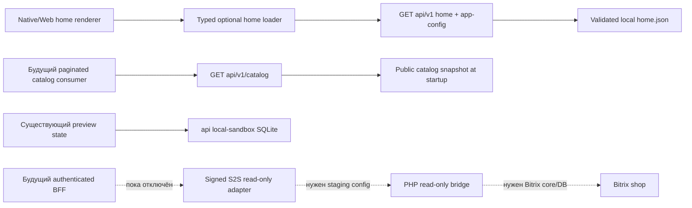

# Архитектура V7 slice A — состояние реализации

11.09.2026. Выбор клиента: `docs/adr/001-mobile-stack.md`. Детальный статический аудит: `docs/discovery/backend-audit.md`. Текущий этап создаёт публичный BFF contract и исправляет guard подготовленного read-only bridge; не подключает реальные формы и checkout.



## Реализованные границы

`server/public-v1.mjs` содержит публичные capabilities, config validation и pagination. `server/app.mjs` регистрирует три exact GET route и общий Origin/method/error policy. Публичные GET не создают sandbox сессии и не меняют корзину. Backend-подзадача не выполняла deployment; root развернул изолированный V7 release `v0.7-20260911-01` после финального QA. См. `deployment-v7-verification.json`. Node API сохраняет bind 127.0.0.1, отдельный preview proxy — порт 18087. Это не публикация магазинов или подключение production Bitrix.

`server/content/home.json` — server-controlled порядок ограниченных native slots. Immutable IDs отделены от позиции массива. Неверная конфигурация возвращает встроенный fallback; произвольные URL/HTML/JSX не разрешены. Возможность редактировать этот файл не даёт permission на заказ, маркетинговое согласие или сообщения.

`mobile/src/api/home.ts` стартует независимо от identity, не хранит token, не отправляет credentials, валидирует response и даёт bounded fallback. UI может сразу использовать `defaultHomeConfig`; серверный запрос не должен блокировать startup. Native требует явного approved API base; неизвестный production домен не подставляется.

`/api/v1/catalog` публикует страницы публичного снимка с доказуемым происхождением и process-local signed cursors. Город/контекст — публичные параметры представления, не цена по договору/доступ компании. Синтетический stock заменён на null. `oldPriceKopecks` выдаётся только из валидного исходного значения выше текущей цены. Клиент не рассчитывает коммерческие права/остатки из snapshot.

Снимок загружается в память при старте; это достаточно для текущей UI-проверки, но не архитектурное решение для поиска 100 000 SKU. Настоящая каталогизация/фасеты/цены остаются в Bitrix; дальнейший адаптер должен использовать pagination/search/provider и измеренную стоимость запросов. Нагрузочные показатели большого рабочего каталога не заявлены.

Согласованное изменение sandbox: сравнение расширено до шести товаров по master-плану. Проверка седьмого, удаление из набора, сохранение после SQLite reopen и нормализация legacy comparison выполняются сервером; авторизация и коммерческие расчёты не затронуты.

## Исправление нового PHP bridge

`Bridge::assertUserActive()` теперь отклоняет отсутствующего/неактивного пользователя и любой truthy `UF_DELETE_ACCOUNT_BY_USER`. Это сохраняет логику исходного login, потому что исходный delete action меняет флаг, а не ACTIVE. `ReadOnlyBitrix::assertActorActive()` вызывает guard до membership/query/export; порядок одинаков для order.export, documents.manifest, notifications.export и preferences.export. Выдача прав всё ещё требует доверенного server actor, pilot allowlist, owner/context и свежего членства.

Пользователь читается через `CUser::GetList` с явным SELECT поля UF_DELETE_ACCOUNT_BY_USER и FIELDS ID/ACTIVE. Отсутствие поля возвращает BITRIX_SCHEMA_MISSING, а не предполагает, что удаление не запрошено. Правило SELECT пользовательских полей соответствует [документации Bitrix GetList](https://www.dev.1c-bitrix.ru/api_help/main/reference/cuser/getlist.php?print=Y).

Новый `ReadOnlyBitrix.test.php` использует только локальные stubs Loader/CUser и новые классы; отсутствуют Bitrix core, БД и network. Он проверяет отклонение 4 типов недоступного пользователя и отсутствующего поля на всех 4 операциях до доступа к данным. `Bridge.test.php` дополнен вариантами активного/удалённого пользователя и неполной схемы. Эти тесты не объявляют совместимость всех ORM/sale events с отсутствующим core.

Исходный `site-source` не изменён. Source self-join USER_IDS по ИНН, CRM TLS/event blockers, OTP concurrency и raw-card flow остаются отдельными блокерами реального backend, а не скрыто исправленными в этой итерации.

## Что остаётся закрыто

Все live write capabilities равны false. Mobile forms/commerce по-прежнему отделены от песочницы. Не созданы реальные auth/refresh sessions, B2B roles, commercial quotes/orders, PSP sessions, CRM сделки, 1С документы, consent записи, push registration или рассылки. Вызовы read-only bridge на staging не выполнялись; наличие класса/контракта не равно подключению.

Следующий реальный vertical slice после доступов: проверенный guest Bitrix catalog/search/product DTO → identity с revocation/RBAC → чтение собственных заказов/документов → checkout через восстановленные existing events с idempotency. Прямой второй CRM lead из BFF исключён.

## Воспроизводимость проверок

Команды с Node 24:

```sh
node --test server/test/*.test.mjs
```

В каталоге `mobile`:

```sh
node --import tsx --test tests/home-api.test.ts
node node_modules/typescript/bin/tsc --noEmit
```

Для отдельной разрешённой PHP CLI среды, без Bitrix bootstrap:

```sh
php -n -d extension=mbstring integrations/bitrix/test/Bridge.test.php
php -n -d extension=mbstring integrations/bitrix/test/ReadOnlyBitrix.test.php
```

После последних согласованных изменений schema: **49/49 Node server tests**, **5/5 home loader tests**, `tsc --noEmit` — успешно. Отдельный smoke на фактических данных через временный localhost API с SQLite `:memory:`: **28/28 товаров**, 9 home slots, 23 валидных oldPriceKopecks; stock=null и checkoutEligible=false. Это небольшой snapshot, не benchmark 100 000 SKU.

OpenAPI JSON разобран и все 24 внутренних `$ref` разрешены; специализированный OpenAPI-validator в окружении не установлен, полная инструментальная schema conformance этим не заявляется.

Root выполнил отдельный прогон на PHP 8.4.23: **40 policy checks + 20 export revocation checks PASS**, [php-tests-v7.log](php-tests-v7.log). Загружались только новые src/test в изолированном каталоге, без Bitrix core/БД/network clients; `php -n -d extension=mbstring` включает нужный модуль только этому процессу, серверный конфиг не менялся. Первый чистый `-n` выявил отсутствие mbstring, требуемого Bridge::text; это устранено параметром процесса и подтверждено успешным повтором.

Общий root прогон: **50 server/preview tests** ([server-tests-v7.log](server-tests-v7.log)) и **48 mobile tests** ([mobile-tests-v7.log](mobile-tests-v7.log)); отдельный поздний QA спецификации — **7/7** ([qa-v7-quick-order-tests.log](qa-v7-quick-order-tests.log)). Это результаты соответствующих логов, а не сумма уникальных тестов. EAS non-preview pre-install hook закрывает неподготовленную release-сборку, faceIDPermission=false. Подписанные мобильные бинарники и signing ещё отсутствуют. Ни один из этих прогонов не является native/store/production-acceptance.
