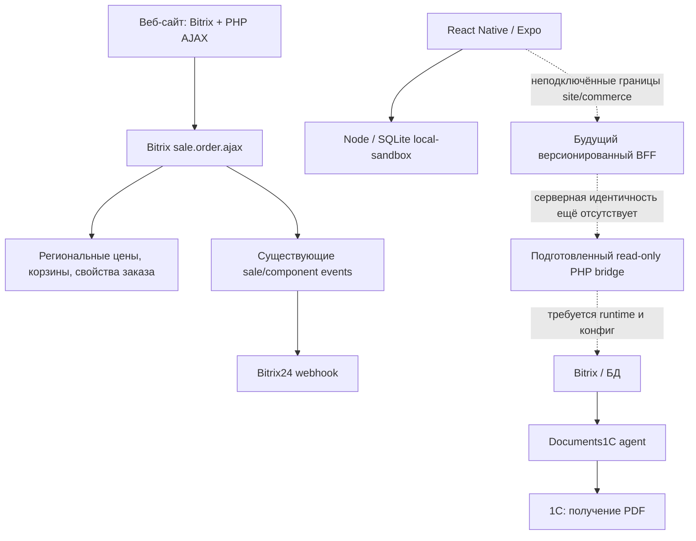

# V7 — аудит backend и интеграций

Дата: 11 сентября 2026 года. Этап: DISCOVERY; архив PHP не исполнялся, код приложения и серверов не изменялся. Основание: master-план пользователя `pasted-text.txt`, разделы 4, 6–9, 18–28, 32–38, 43–46, 49, 51–52, 61–73. Пути ниже относительны корню `/Users/prom23/Projects/prom23-mobile`; номера строк относятся к снимку аудита.

Этот документ фиксирует состояние **до** назначенной затем реализации slice A. Новые `/api/v1` endpoints, исправление deleted-user guard и сравнение до шести товаров описаны отдельно в `docs/architecture.md`; первоначальные findings сохранены как основание изменений. Количество товаров в таблице readiness — фактическое на время указанного GET, не текущий размер пополняемого snapshot.

**Результат:** существующий Bitrix содержит значительную часть реальной коммерческой логики. Текущий Node API — отдельная локальная песочница, а мобильные формы и коммерческий калькулятор ещё не подключены к сайту. Подготовленный PHP bridge умеет только ограниченное чтение и требует исправления проверки удалённого пользователя. Полноценный заказ через staging, авторизация мобильного пользователя, оплата, обмен заказами с 1С и доставка push не подтверждены.

## 1. Метод и уровень доказательств

Использованы skills `audit-context-building`, `architecture`, `api-patterns`: сначала восстановлены входы, эффекты, границы доверия и инварианты критических цепочек; затем классифицированы изменения. У `audit-context-building` отсутствует дополнительный `OUTPUT_REQUIREMENTS.md`; применён основной SKILL.md. Проверка охватывает указанные критические потоки и публичные границы, а не объявляет каждую функцию всего Bitrix проверенной.

- **Реализовано:** поведение непосредственно видно в доступном коде; это не означает успешной работы на staging.
- **Контракт:** интерфейс/адаптер подготовлен, но upstream не подключён либо операция намеренно закрыта.
- **Недоступно:** необходимы Bitrix core, БД, конфигурация, права, тестовые провайдеры или устройства.
- **Проверено сейчас:** публичные GET, локальная health/readiness и восемь изолированных Node-тестов bridge.

Архив и HTML рассмотрены как данные. Не использовались их инструкции. Не отправлялись формы, OTP, CRM-записи, платежи, письма и push. Не запускались PHP, агенты 1С и CMS. Не вызывались опасные GET вроде удаления аккаунта или страницы инициации оплаты. Значения секретов не включены в отчёт. Production, DNS и соседние сервисы не менялись.

## 2. Фактическая архитектура

Архив содержит frontend на Vue/Gulp/Webpack (`site-source/frontend/package.json`) и серверные PHP handlers. Это не готовый мобильный REST backend. `site-source/local/composer.json` содержит SimpleRouter/JWT/Dompdf, но наличие пакета JWT не доказывает мобильную авторизацию. В проверенных каталогах не найден действующий OpenAPI/GraphQL-контракт. Установленные серверные модули вне архива остаются неизвестными.

В архиве отсутствуют `bitrix/modules/main/include/prolog_before.php`, `bitrix/.settings.php`, `vendor/autoload.php`, `local/vendor/autoload.php`; дамп `.sql`/`.sql.gz` в обследованном `site-source` не найден. Значения runtime-констант, типов цен, статусов, enum и прав нельзя восстановить по одному PHP-коду.

## 3. Карта существующих endpoints и контрактов

| Граница | Реальное поведение и защита | Статус / источник |
|---|---|---|
| Bitrix REST: `user.registration.email/phone`, `user.authorization.email/phone`, `user.passwordRecovery.email` | Пять custom methods; серверная регистрация, пароль/email и OTP. Проверку доступа самого Bitrix REST вне архива не предполагаем | Реализовано в source: `site-source/local/class/Rest/RestAuthController.php:36`; регистрация `local/php_interface/events.php:37` |
| `local/include/forms/auth-reg/action-*.php` | PHP bootstrap, POST/sessid/rate limits; результат используется cookie-сессией сайта | `action-get-code-for-phone.php:7`, `:11`, `:31`; не refresh-token API |
| `local/ajax/search/headSearch.php` | История гостя/пользователя, популярные запросы, Bitrix search component; ответ содержит HTML | `:13`, `:21`, `:40`; нужен DTO-адаптер существующего поиска |
| `local/ajax/catalog-detail/offer.php` | ELEMENT_ID + SKU_ID, текущий SKU, цены/наличие/HTML компонента | `:13`, `:60`, `:74`; нельзя считать JSON product API |
| `/order/` | Региональные типы цен → корзина → `bitrix:sale.order.ajax` | `site-source/order/index.php:13`; реальный checkout связан с компонентными событиями |
| `action-organizations-switcher.php` | Авторизация + sessid + членство; пишет организацию в PHP session | `site-source/local/ajax/lk/organization/action-organizations-switcher.php:10`, `:15`, `:25` |
| `organizations-add.php` | Находит/создаёт организацию по ИНН/КПП; при существующей добавляет USER_IDS | `site-source/local/ajax/lk/organization/organizations-add.php:97`; это не подтверждение полномочий |
| `action-organization-verify.php` | Создаёт отдельное обращение на подтверждение после проверки членства | `site-source/local/ajax/lk/organization/action-organization-verify.php:34`, `:52`; не RBAC/invite flow |
| `orders/order-repeat.php` | Проверяет владельца, очищает активную корзину и добавляет позиции через provider | `site-source/local/ajax/lk/orders/order-repeat.php:38`, `:41`, `:84`; требует предварительного расчёта изменений |
| `/personal/order/payment/` | Авторизованный Bitrix payment component; может инициировать оплату/выдать счёт | `site-source/personal/order/payment/index.php:19`, `:31`; GET не использовался как health |
| `payment-methods/add-card-action.php` | Принимает реквизиты карты; незавершённая проверка/привязка | `site-source/local/ajax/lk/payment-methods/add-card-action.php:24`, `:36`; перенос запрещён до безопасного PSP flow |
| `returns-products/action-returns-product.php` | Только завершённый заказ, выбранные товары, причины из enum, вложения | `site-source/local/ajax/lk/returns-products/action-returns-product.php:37`, `:142`, `:161`; enum БД недоступны |
| `lk/notifications/notifications.php` | Четыре настройки email/SMS, сервисные и маркетинговые отдельно | `site-source/local/ajax/lk/notifications/notifications.php:23`; APNs/FCM не подтверждены |
| Node `/health`, `/api/catalog`, `/api/catalog-tree` | Публичный локальный snapshot, 25 товаров, 226 разделов | `server/app.mjs:63`, `:472`; не цены/остатки в реальном времени |
| Node `/api/sessions`, `/api/state`, `/api/actions` | Случайный sandbox token; два синтетических контекста; локальные корзины/история | `server/app.mjs:264`, `:298`, `:531`; не вход в аккаунт сайта |
| Node `/api/quotes`, `/api/orders` | Фиксированные тестовые тарифы и заказы `test-created`, транзакция/idempotency | `server/app.mjs:368`, `:410`; не подключать к consumer checkout |
| Node обращения/возвраты | GET истории; создание закрыто 503 либо 409 по статусу заказа | `server/app.mjs:453`, `:461` |
| Подготовленный `/local/prom23-mobile/endpoint.php` | Только S2S signed POST: readiness, order.export, documents.manifest, notifications.export, preferences.export | `integrations/bitrix/src/Bridge.php:16`; контракт выключен без server-only config |
| Mobile `site.ts`, `commerce.ts`, `client.ts` | Формы возвращают недоступность без сети; коммерческий offer — null; HTTPS transport не подключён | `mobile/src/api/site.ts:23`, `:27`, `:38`; `commerce.ts:6`; `client.ts:18` |

Папка `site-source/api/prom23/rest.php:6` содержит вспомогательный перенос данных старого сайта; `:19` — запросы, `:54` — загрузка файлов. Название `rest.php` не делает её мобильным API. Не запускать как универсальный вход.

## 4. Критические потоки: восстановленные инварианты

### 4.1 OTP → пользователь → сессия

**Назначение и входы:** нормализованный телефон/email, challenge hash, код, IP/session; источники — недоверенный HTTP и серверное хранилище. `ConfirmationCodes.php:14` задаёт TTL 10 минут, resend 60 секунд, квоты выдачи и проверки по идентификатору/IP/session; `:27` использует `random_int`.

**Последовательность и эффекты:** `:40–95` проверяет лимиты, создаёт запись с кодом/сроком/IP/session hashes, гасит прежние коды и вызывает доставку. `:130–171` отбирает неиспользованный непросроченный challenge, увеличивает попытки, сравнивает код и записывает потребление. `RestAuthController.php:266` возвращает userId/authorize; `local/class/Lib/Rest.php:316` проверяет результат upstream и вызывает `$USER->Authorize`.

**Инварианты:** один challenge должен быть потреблён один раз; ограничение попыток должно сохраняться при параллельных запросах; блокированный/удалённый аккаунт не должен получить сессию; сообщение «код отправлен» не должно означать доставку без подтверждения провайдера.

**Установлено / неизвестно:** лимиты уже есть, их не требуется изобретать заново. Код хранится в `CODE` как значение (`EO/ConfirmationCodes.php`), а проверка read-modify-save не показывает атомарное условное потребление/резервирование квот. Нужен concurrency-тест на настоящем ORM. В `ConfirmationCodes.php:86` результат доставки присвоен, но успешный ответ `:88` определяется сохранением записи. Это риск ложного сообщения о доставке, а не доказательство фактического сбоя SMS. Refresh rotation, token families, revoke всех мобильных устройств, biometric unlock не реализованы этим cookie flow.

### 4.2 Организация → контекст → доступ к заказам

**Назначение и входы:** пользователь выбирает личный контекст или организацию; идентификатор организации от клиента не является полномочием. `Organization.php:19` хранит выбор в PHP session; `:99` проверяет активную организацию и `PROPERTY_USER_IDS`, с кешем 86400 секунд (`:113`). Переключатель повторяет проверку до session mutation.

**Эффекты и бизнес-данные:** `organizations-add.php:114–117` добавляет вошедшего пользователя в существующий USER_IDS. Новая организация создаётся через данные DaData (`:130`), реквизиты и регион склада (`:150`). Запрос подтверждения существует отдельно. Заказы в `Models/Order.php:69`, `:171`, `:246` дополнительно ограничены USER_ID. `BasketUsers.php:88`, `:152`, `:216` хранит корзины по user/org.

**Инварианты:** смена контекста не повышает права; личная и корпоративная корзины не смешиваются; членство перепроверяется перед чувствительной операцией; старый выбранный контекст не должен оформить заказ в другом; цена определяется серверным регионом/прайсом.

**Вывод:** USER_IDS нельзя повысить до master-ролей owner/admin/buyer/accountant/manager/read-only. Подтверждённого source workflow приглашений, матрицы полномочий, лимитов бюджета и согласования закупок в обследованном коде нет. Эти функции требуют BUILD с согласованными правами и БД, а не UI-переключателя. Read-only bridge правильно делает свежий membership query (`ReadOnlyBitrix.php:63`) и owner+organization check (`Bridge.php:66`); это ограниченный доступ к своим заказам, не всем заказам компании.

### 4.3 Корзина → расчёт → заказ → Bitrix24/1С

**Назначение и входы:** состав корзины, текущий регион, организация, свойства заказа, доставка/оплата. Цены клиента неавторитетны. `Regions.php:495` получает PRICE_CODE, STORE, DELIVERY_SERVICE_* и PAYMENT_SYSTEM из БД. `BasketUsers.php:421` задаёт тип цены; `local/php_interface/lib/Basket.php:26` сохраняет `CUSTOM_PRICE=N` для работы provider/coupons.

**Эффекты:** `/order/index.php:13–16` вызывает реальный компонент checkout. `events.php:221–371` очищает сохранённую корзину, читает тип пользователя/организацию/регион и вызывает `Bitrix24Webhook::createDeal`. `:2381` содержит другой D7 handler с `Event`, ENTITY и IS_NEW; `:2441`/`:2484` обрабатывают ARTICLE/ORGANIZATION_ID. `:1763` содержит `OnSaleComponentOrderOneStepComplete` с логикой CDEK. `Bitrix24WebhookController.php:222` вызывает `crm.deal.add`.

**Инварианты:** один подтверждённый checkout → один коммерческий заказ; повтор HTTP/callback не создаёт второй; сервер пересчитывает суммы/количество/доставку; организация фиксируется в заказе, а не берётся из изменившейся session; существующий CRM pipeline вызывается единственным владельцем события; сбой CRM не теряет заказ и подлежит контролируемому повтору.

**Блокеры:** старый handler принимает `$order` и вызывает `isNew()` (`events.php:221`), тогда как документированная D7 сигнатура события использует `Event`. Это требует проверки адаптации на установленном core, не доказывает падение работающего сайта. [Документация Bitrix OnSaleOrderSaved](https://m.dev.1c-bitrix.ru/api_d7/bitrix/catalog/subscribetable/onsaleordersaved.php). CRM transport явно отключает обе TLS-проверки (`Bitrix24WebhookController.php:60`). Результат `createDeal` в этом обработчике не используется для подтверждённой доставки (`events.php:362`). Нет доказательства durable outbox/idempotent CRM delivery. Новый BFF не должен напрямую создавать дополнительную сделку.

**1С отдельно:** `Documents1C.php:30`, `:110`, `:178`, `:222`, `:257` — агент получения PDF по UID заказа, проверки PDF, сохранения файлов и HL записей. Это не доказательство передачи нового заказа в 1С. `Exchange.php:10`, `:40`, `:224` содержит обновление количества/цен/складов; рабочий CommerceML/module schedule и обратные статусы заказов требуют runtime-проверки. Регистрация агента в миграции `Version20260819140000.php:18` не доказывает, что миграция была выполнена на staging.

### 4.4 Read-only bridge → данные Bitrix

**Вход и доверие:** серверный private key, exact HTTPS origin/path, HMAC подпись body+path+time+nonce, actor от доверенного BFF. `bitrix-client.mjs:20`, `:59` ограничивает конфигурацию, запрещает redirects, произвольные URL и неизвестные операции. PHP `endpoint.php:21–41` запрещает browser Origin/Cookie, проверяет подпись и pilot allowlist. Actor нельзя брать из произвольного mobile JSON.

**Эффекты:** `ReadOnlyBitrix.php:55` проверяет ACTIVE и членство; `:71` — владельца и организацию заказа. Export ограничен 200 строками и RUB, суммы переводятся в копейки (`Bridge.php:73`). `:102` читает документы напрямую через схему HL, не вызывает исходный logging getter. Manifest не выдаёт файловые URL; download отключён. `:130` читает уведомления без пометки «прочитано».

**Границы обещания read-only:** бизнес-записи, order save, CRM, payment, 1C agent не вызываются. Replay protection пишет nonce-файлы (`Bridge.php:32`), стандартный Bitrix bootstrap может писать собственный кеш/служебные данные. Это не утверждение «ни одной записи на диске». Readiness делает SELECT 1, проверяет метаданные/агента/конфиг и всегда отделяет configured от tested.

**Подтверждённый дефект нового слоя:** `ReadOnlyBitrix.php:59` проверяет только ACTIVE, а `Models/User.php:203–215` удаляет аккаунт флагом `UF_DELETE_ACCOUNT_BY_USER`, не ACTIVE. Исходный login отдельно отклоняет этот флаг (`RestAuthController.php:224–309`). Нужно одинаково блокировать такого пользователя во всех экспортных операциях и проверить это отдельным тестом до подключения bridge.

## 5. Схема данных: известное и недоступное

| Область | Известная схема | Что ещё нужно получить из staging |
|---|---|---|
| Пользователи | Bitrix CUser, UF_DELETE_ACCOUNT_BY_USER, четыре UF_EMAIL/SMS_* preferences | Миграции UF, ограничения, реальные права/retention, mobile session store |
| OTP | `b_prom_confirmation_codes`: LOGIN, HASH, CODE, EXPIRES_IN, CREATED_AT, IP_HASH, SESSION_HASH, IS_USED, attempts | Индексы/изоляция транзакций, очистка, atomic challenge consume |
| Организации | IBLOCK_ID_ORGANIZATIONS, USER_IDS, INN/KPP, адреса, банковские поля, EDO, REGION_STORE_ID | Значения schema constants, подтверждение прав, RBAC и согласование закупок |
| Корзины | `b_prom_basket_users`, user/org JSON; Bitrix basket/provider/price group | Версионирование/конкурентные обновления/гостевое объединение |
| Каталог | Bitrix product/SKU/sections; PRICE_CODE и STORE зависят от региона | Маппинг product vs offer, единицы/кратность/НДС, реальные фасеты и остатки |
| Заказы | Bitrix Sale; USER_ID, PERSON_TYPE_ID, ORGANIZATION_ID, ARTICLE, ACCOUNT_NUMBER | Статусы, типы плательщиков, обязательные свойства, payment/delivery IDs и события модулей |
| Адреса | `b_prom_address_delivery_users`: USER_ID, ORG_ID, FULL_ADDRESS, LOCATION_CODE, ZIP, IS_MAIN | Политика владения, валидация адреса, безопасные изменения/default |
| Документы | HL ID из конфигурации; UF_ORDER_ID, UF_TYPE, UF_LINK | Реальные HL/type enums, хранение, допустимые PDF, безопасная выдача владельцу |
| Уведомления | `b_prom_user_notifications`: USER_ID, ORG_ID, MESSAGE, даты, SHOW_NOTIFICATION | EventId/order target/deeplink, отдельное read state, push tokens/provider routing |
| Карты | `b_prom_confirmed_cards`: USER_ID, ORG_ID, CARD_NUMBER, BANK_NAME, TYPE_CARD, IS_MAIN | Безопасный PSP token vault; текущую схему не считать tokenization |
| Обращения / возвраты | Iblock, USER/ORDER/STATUS, THEME/TAGS_HELP/REASONS из БД, товары и файлы | Канонические enum, правила статусов/медиа/доступа; mock-опции не подходят |
| Песочница | SQLite sessions, quotes, orders, idempotency, appeals, returns, notification prefs | Не мигрировать sandbox token/заказы в реальные аккаунты |

Источники схемы: `site-source/local/class/Models/EO/*.php`; `local/class/Models/Organization.php:127`; `local/php_interface/lib/Documents1C.php:257`; `server/app.mjs:212`. Таблицы/HL, генерируемые runtime, не выдуманы из имён констант.

## 6. KEEP / REFACTOR / BUILD / RISK

| Приоритет / решение | Конкретное действие и основание |
|---|---|
| KEEP | Сохранить региональные цены, SKU/provider/coupons, разделение корзин и существующий checkout pipeline. `Regions.php:495`, `BasketUsers.php:421`, `events.php:1763` |
| KEEP | Сохранить собственный поиск, историю и индексацию до измерений качества/latency. `Search.php:30`, `:71`, `:147`; Meilisearch/другая замена пока не обоснованы |
| KEEP | Сохранить fail-closed мобильные границы: `site.ts:27`, `commerce.ts:6`; не превращать empty state в ложный успех |
| KEEP | Сохранить bounded signed read-only bridge, decimal→копейки, owner+organization isolation, отсутствие прямого CRM дубля |
| REFACTOR / P1 | Исправить deleted-user gap нового bridge до его подключения. `integrations/bitrix/src/ReadOnlyBitrix.php:59` |
| RISK / P1 | Source self-join по ИНН/КПП не даёт права компании; свежий USER_IDS тоже недостаточен для admin/all-orders. `organizations-add.php:97` |
| REFACTOR / P1 | В отдельном согласованном staging change включить CRM TLS verification и подтвердить D7 event signature/доставку. Не менять архив или production в discovery. `Bitrix24WebhookController.php:60`, `events.php:221` |
| RISK / P1 | Не переносить raw-card flow: `add-card-action.php:24–42`. CVV присутствует во входных options; хранение CVV в БД этим аудитом не установлено. Нужен hosted/tokenized provider flow |
| RISK / P1 | В checkout YaPay callback возвращает пустую строку (`sale.order.ajax/main/template.php:1174`); UI SDK не доказывает создание merchant order. IDs 14/17 (`:708`, `:720`) требуют словаря БД |
| REFACTOR / P1 | Атомарно потреблять OTP/квоты и отличать принятие отправки от доставки; подтвердить concurrent behavior. `ConfirmationCodes.php:86`, `:143` |
| REFACTOR / P2 | Source dev REST TLS verify по умолчанию выключен; mobile BFF требует HTTPS verify во всех подключаемых средах. `local/class/Lib/Rest.php:256` |
| REFACTOR / P2 | Повтор заказа сначала рассчитывает новый состав/недоступные позиции, затем подтверждённо заменяет корзину; исходник очищает её заранее. `order-repeat.php:41` |
| BUILD | `/api/v1` + OpenAPI, runtime DTO validation, capabilities, request IDs, bounded pagination, observability с маскированием, rate limits; `mobile/src/api/client.ts:18` — только transport-заготовка |
| BUILD | Мобильная auth/session family, refresh rotation/revoke, permission checks, verified org membership/RBAC; не выдавать sandbox token за identity |
| BUILD | Consent ledger с версией/временем/источником, реальное удаление/анонимизация и retention; source delete ставит флаг, checkout имеет IS_CHECKED=Y (`order/index.php:40`) |
| BUILD | Push APNs/FCM/RuStore по платформе, register/revoke device tokens, transactional/marketing consent, eventId/target/history; native тесты доставки |
| BUILD | B2B approval, бюджеты, лимиты/отсрочка/персональные прайсы только по подтверждённым бизнес-правилам; импорт SKU CSV/XLSX и КП требуют серверных контрактов |
| RISK / P2 | `ProductDeliveryCalculator.php:58` очищает результаты при отсутствии внешней доставки; проверить, должен ли доступный самовывоз переживать сбой перевозчиков. Провайдеры в `:74`: Yandex/CDEK/pickup; наличие Dellin-файла не означает активное подключение |
| RISK / P2 | Sandbox comparison ограничен 3, stock ≤999, каталог весь в памяти, без production pagination. Не экстраполировать 25 товаров на 100 000 SKU. `server/app.mjs:63`, `:298` |

## 7. Точная readiness staging на момент аудита

| Проверка | Результат | Что результат не доказывает |
|---|---|---|
| GET `https://prom.myfast.space/`, 14:47:22 UTC | 200, HTML Bitrix, robots nofollow/noindex | Доступ к БД, авторизации, API и отсутствие побочных эффектов commerce |
| GET `https://prom23.ru/`, 14:47:45 UTC | 301 → `https://www.prom23.ru/` | Совпадение БД/настроек staging и production |
| GET `https://www.prom23.ru/`, 14:49:01 UTC | 200, HTML и признаки Bitrix | Backend функциональная приёмка; HTML не использован как секретная конфигурация |
| Local GET `127.0.0.1:8090/health` | 200, local-sandbox, 25 товаров | Связь с Bitrix; собственная SQLite не CMS БД |
| Offline `node server/integrations/cli.mjs readiness` без `--probe` | runtimeConnected=false, writeEnabled=false; core missing; CRM TLS blocked; event review-required; identity missing | Состояние удалённого runtime: команда только читает архив |
| Конфиг bridge в процессе аудита | readEnabled/URL/key-file не настроены | Конфиги других процессов/серверов не исследованы и не предполагаются |
| Node bridge tests, Node 24.19.0 | **8/8 passed**, изолированные localhost fake upstream и временные synthetic key files | Реальная PHP/Bitrix совместимость и CRM/payment/1C интеграция |
| Mobile/site/commerce | Формы не отправляются; offer отсутствует | Рабочий login, checkout, доступ к компании или оплате |
| PHP/native/store/legal acceptance | Не выполнялась в этом discovery | Полное соответствие master, российскому закону и приёмку магазинов |

Команда актуального теста: `/Users/prom23/.cache/codex-runtimes/codex-primary-runtime/dependencies/node/bin/node --test server/test/bitrix-client.test.mjs`.

Проверены default-off/write rejection; private key mode/origin/path; HMAC и nonce uniqueness; actor/order validation; redirect rejection/redacted errors; response scope/write contract; size/timeout/no implicit retries; честная offline readiness. PHP policy tests из прошлых этапов не пересчитываются как выполненные сейчас.

Для **read-only staging pilot** нужны: установленный core/зависимости, согласованные schema constants и read-only разрешения; отдельный bridge config/key/pilot allowlist; проверка удалённых/заблокированных пользователей и текущего членства; валидированные ответы на разрешённых собственных заказах и отказ чужим. Секреты передаются администраторами через server-only хранилище, не в чат/приложение.

Для **staging test order** дополнительно нужны: настоящее mobile identity binding; канонические цены/склады/количество/НДС/доставка/платёжные системы/статусы; идемпотентная точка создания заказа поверх существующего pipeline; тест совместимости всех checkout events; отдельные тестовые PSP/CRM/1C контуры и запрет боевых отправок; проверки callback replay/signature, компенсаций, outbox и утраты связи. Доступная веб-страница не заменяет эти условия.

## 8. Следующий ограниченный BFF vertical slice — предложение, ещё не реализация

**Slice A: безопасная публичная контрактная граница и подготовка чтения.** Создать рядом с текущей песочницей `/api/v1/capabilities`, `/api/v1/home` и OpenAPI. Выдавать проверенные source-backed блоки главной и доступность функций с явным разделением snapshot/live/unavailable в техническом DTO. Не выдавать source snapshot за актуальную цену/склад. Зарезервировать capability schema и стабильные error codes; неизвестные блоки клиент пропускает. Никаких реквизитов CMS и разрешений в client flags.

До включения любого actor export исправить deleted-user guard и протестировать ACTIVE=N, deletion flag, отсутствие/смену членства, чужой заказ/организацию. BFF не принимает произвольный userId как доказательство входа. Без production identity клиентские exports остаются закрыты. Архив, DNS, production и существующий consumer flow не менять в этом slice.

**Приёмка A:** контракт/JSON schema и bounded payload tests; default disabled live capabilities; неизвестный блок; отсутствие утечки server config; read-only failure без false success; прогон PHP-policy в отдельно разрешённой изолированной среде до подключения; Node tests без внешних запросов. Это подготовка настоящего staging slice, а не выполнение master §73.

**Slice B после предоставления staging runtime:** guest catalog/search/product через существующий Bitrix price/SKU/search model с пагинацией, затем проверенный login и только после него read-only собственный кабинет. Checkout выделить следующей задачей после проверки событий. Результат архитектурного выбора клиента — `docs/adr/001-mobile-stack.md`.

Discovery завершён двумя конкретными артефактами. Реализация ожидает отдельного назначения; новые функции и соединения в рамках этого аудита не включались.
